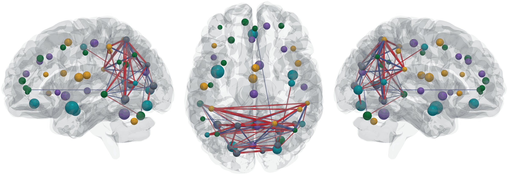

# htfa

<picture>
  <source media="(prefers-color-scheme: dark)" srcset="docs/_static/cover_dark.png">
  
</picture>

<sub>Illustrative movie-viewing analysis: an HTFA template (K = 50) fitted to 12 adults watching Pixar's <i>Partly Cloudy</i>, from Nilearn's <code>development_fmri</code> dataset, viewed from the left, above and right. Inter-subject functional correlation (ISFC) measures correlations between participants' factor time courses at matching moments of the film. Edges show the strongest 5% of factor pairs (|ISFC| &ge; 0.137; red positive, blue negative). Node size represents factor width; node colour identifies communities in the positive-ISFC graph. See the <a href="https://htfa.readthedocs.io/en/latest/tutorials/10_dynamic_isfc_animation.html">ISFC tutorial</a> for the analysis workflow.</sub>

[](https://pypi.org/project/htfa/)
[](https://github.com/ContextLab/htfa/actions/workflows/tests.yml)
[](https://htfa.readthedocs.io/en/latest/?badge=latest)
[](LICENSE)

## Overview

Topographic factor analysis (TFA) models a data matrix `X` (voxels by time points) as `X ≈ F W + noise`. Each of the `K` factors is a spatial kernel, or a mixture of kernels, with fitted centers and widths in coordinate space. `W` holds the factors' weights over time [1]. Hierarchical TFA (HTFA) fits TFA to several subjects at once, with a global template that the per-subject factors are tied to [2, 3, 4].

The examples use simulated data, movie-viewing fMRI, a word-viewing experiment, and ordinary 2D images to illustrate different parts of the API. TFA and HTFA do not require a particular task: the inputs are observations at spatial coordinates. HTFA fits can have different time-series lengths across subjects; analyses that correlate subjects at matching time points, such as ISFC, additionally require aligned samples.

htfa is a standalone Python implementation of these algorithms. Its numerical validation includes comparisons with [BrainIAK](https://brainiak.org); BrainIAK is not a runtime dependency.

- No MPI or local compilation is needed when installing the prebuilt dependency wheels for a supported platform.
- Analytic Jacobian for the center/width least-squares problem (`htfa/_kernels.py`).
- A NumPy engine and a torch engine (CUDA, Apple Metal, CPU), chosen with the estimators' `backend` argument; `auto` uses a GPU only for large problems when torch is already installed.
- Two solver modes: `mode='fast'` (the default) and `mode='exact'` (the reference for numerical equivalence and BrainIAK checks). The modes optimize the same objective but can reach different local minima; see [Performance](https://htfa.readthedocs.io/en/latest/performance.html) and [Validation](https://htfa.readthedocs.io/en/latest/validation.html).
- Factor shapes: Gaussian (`kernel='rbf'`, the default), `'laplace'` and `'mexican_hat'`, and mixtures of several components per factor (`n_components`).
- Nested subject groups with group-level templates and permutation comparisons.
- Reconstruction R² and nominal conditional Gaussian AIC, AICc and BIC (`htfa.stats`).
- Inputs: NIfTI files and folders, nilearn/nibabel objects, numpy arrays and 2D images.
- Synthetic data with ground truth (`htfa.synthetic`), factor-level connectivity, a results object, and BrainNet Viewer-style 3D network plots (`htfa.brainnet`).

## Quick tour

Generate synthetic data for three subjects with known factor parameters, fit HTFA, and compare the recovered centers with the truth:

```python
import htfa
from htfa.synthetic import match_factors

Xs, Rs, truth = htfa.make_htfa_data(
    n_subjects=3, grid_shape=(12, 12, 12), n_samples=60, K=5, random_state=0
)
res = htfa.fit(
    Xs, K=5, coords=Rs, standardize=False, max_global_iter=30, random_state=0
)
print(res.global_centers.shape)  # template centers
print(res.weights[0].shape)  # factor time courses of the first subject
print(res.connectivity(0).shape)  # factor connectivity of the first subject
perm = match_factors(truth["centers"][0], res.centers[0])
print(abs(res.centers[0][perm] - truth["centers"][0]).max())
```

Output:

```
(5, 3)
(5, 60)
(5, 5)
0.01688680355447225
```

For real data, pass a folder with one `.nii` / `.nii.gz` file per subject:

```python
res = htfa.fit("path/to/folder", K=50, random_state=0)
```

The inputs `htfa.fit` accepts, its parameters and the results object are described in the [documentation](https://htfa.readthedocs.io/en/latest/) and in [docs/API.md](docs/API.md).

## Installation

Install the [PyPI release](https://pypi.org/project/htfa/):

```bash
pip install htfa
```

For development, using [uv](https://docs.astral.sh/uv/):

```bash
git clone https://github.com/ContextLab/htfa.git
cd htfa
make install
```

`make install` creates `.venv` (Python 3.12) and installs the package with the `dev` and `docs` extras. The package requires Python 3.10 or newer. On Apple Silicon Macs, torch is a core dependency.

### Optional extras

| Extra | Contents |
|-|-|
| `plot` | matplotlib, nilearn |
| `images` | pillow, tifffile |
| `nilearn` | nilearn |
| `gpu` | torch |
| `brain3d` | pyvista, imageio, imageio-ffmpeg, pillow (BrainNet Viewer-style network plots and animations, `htfa.brainnet`) |
| `tutorials` | hypertools, sentence-transformers (only to re-execute the word-decoding tutorial) |
| `dev` | test, lint, type-checking and packaging tools, plus plotting and image dependencies |
| `docs` | sphinx, furo, numpydoc, sphinx-gallery, nbsphinx, and others |

Optional dependencies are installed with pip the first time they are needed, using the versions declared for the extra. To turn this off, set the environment variable `HTFA_AUTO_INSTALL=0` or call:

```python
import htfa

htfa.set_autoinstall(False)
```

## Documentation

The Sphinx site is built from `docs/` with `make docs` (output in `docs/_build/html`). Its pages:

- [Installation](https://htfa.readthedocs.io/en/latest/installation.html)
- [Inputs](https://htfa.readthedocs.io/en/latest/inputs.html)
- [Optional dependencies](https://htfa.readthedocs.io/en/latest/optional_dependencies.html)
- [Tutorials](https://htfa.readthedocs.io/en/latest/tutorials.html)
- [Example gallery](https://htfa.readthedocs.io/en/latest/auto_examples/index.html)
- [API reference](https://htfa.readthedocs.io/en/latest/api.html)

## Testing

```bash
make test
```

By default, tests marked `brainiak` or `network` are deselected. Markers:

- `brainiak`: compares against the reference BrainIAK implementation (requires brainiak)
- `network`: requires network access (downloads data)
- `gpu`: requires a GPU backend (torch with CUDA or MPS)
- `slow`: long-running test

For example, `.venv/bin/pytest -m brainiak` runs the BrainIAK comparison tests.

## Citing

1. J. R. Manning, R. Ranganath, K. A. Norman, and D. M. Blei (2014). Topographic factor analysis: a Bayesian model for inferring brain networks from neural data. *PLoS ONE* 9(5). [doi:10.1371/journal.pone.0094914](https://doi.org/10.1371/journal.pone.0094914)
2. J. R. Manning, R. Ranganath, W. Keung, N. B. Turk-Browne, J. D. Cohen, K. A. Norman, and D. M. Blei (2014). Hierarchical topographic factor analysis. *2014 International Workshop on Pattern Recognition in Neuroimaging (PRNI)*. [doi:10.1109/PRNI.2014.6858530](https://doi.org/10.1109/prni.2014.6858530)
3. J. R. Manning, X. Zhu, T. L. Willke, R. Ranganath, K. Stachenfeld, U. Hasson, D. M. Blei, and K. A. Norman (2018). A probabilistic approach to discovering dynamic full-brain functional connectivity patterns. *NeuroImage*. [doi:10.1016/j.neuroimage.2018.01.071](https://doi.org/10.1016/j.neuroimage.2018.01.071)
4. M. J. Anderson, M. Capotă, J. S. Turek, X. Zhu, T. L. Willke, Y. Wang, P.-H. Chen, J. R. Manning, P. J. Ramadge, and K. A. Norman (2016). Enabling factor analysis on thousand-subject neuroimaging datasets. *IEEE International Conference on Big Data*. [doi:10.1109/BigData.2016.7840719](https://doi.org/10.1109/BigData.2016.7840719)

## Contributing

See [CONTRIBUTING.md](CONTRIBUTING.md).

## License

MIT; see [LICENSE](LICENSE). `htfa/brainnet.py` and `htfa/timecourse.py` adapt code from ContextLab/directed-forgetting-network-dynamics (commit 31a2b66; MIT License, Copyright (c) 2019 Contextual Dynamics Laboratory). The BrainNet Viewer brain meshes used by `htfa.brainnet` are not included; they are downloaded from NITRC on first use (BrainNet Viewer is distributed under the GNU GPL).
