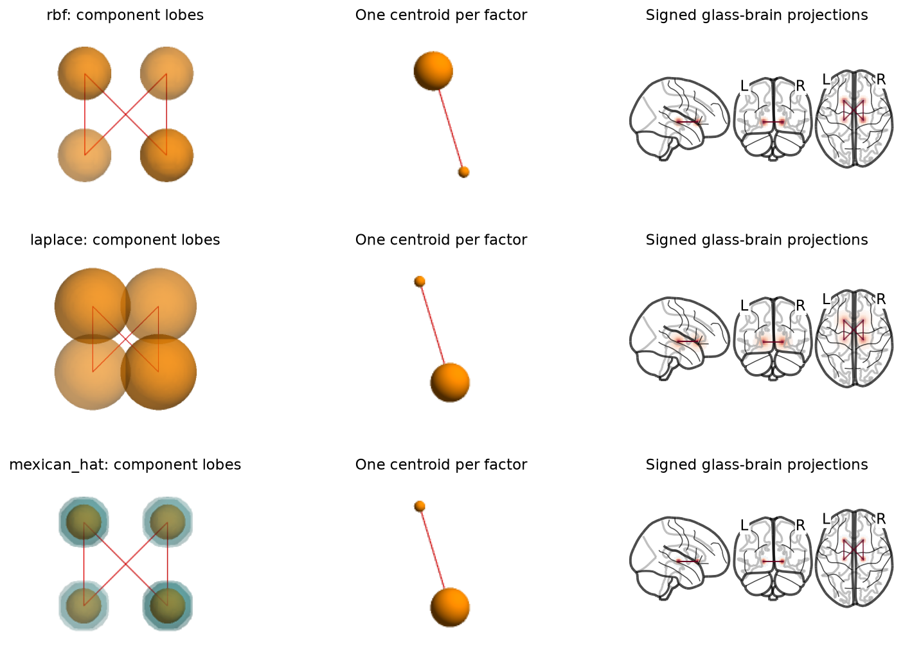

API reference
=============

Fitting
-------

.. autosummary::
   :toctree: generated/
   :nosignatures:

   htfa.fit
   htfa.TFA
   htfa.HTFA
   htfa.HTFAResults

:func:`htfa.fit` loads its inputs and fits :class:`htfa.HTFA` when there are
several subjects, or :class:`htfa.TFA` when there is one. Its ``data``,
``coords``, ``mask``, ``stack``, ``channels`` and ``spacing`` arguments go to
:func:`htfa.load`; the other keyword arguments go to the estimator, and an
unknown keyword raises ``TypeError``. HTFA-only keywords, such as
``max_global_iter``, fail when there is only one subject. See :doc:`inputs` for
the accepted inputs.

Use the estimators directly when you already have arrays:

.. code-block:: python

   from htfa import HTFA, TFA

   # Xs: list of (V_s, T_s) arrays; Rs: list of (V_s, D) coordinate arrays
   model = HTFA(K=20, max_global_iter=30, random_state=0).fit(Xs, Rs)
   model.global_centers_, model.global_widths_  # template
   model.centers_, model.widths_, model.weights_  # per-subject lists

   model = TFA(K=10, random_state=0).fit(X, R)  # X: (V, T), R: (V, D)
   model.converged_reason_  # 'threshold', 'objective', 'plateau' or 'max_iter'

Factors are in template order for HTFA fits: factor ``k`` of every subject
corresponds to global factor ``k``. Widths use the BrainIAK convention
``w = 2 * sigma**2``.

Kernel shapes and mixtures
~~~~~~~~~~~~~~~~~~~~~~~~~~

``kernel`` sets the profile of every factor as a function of ``z = ||r - c||**2
/ w``: ``'rbf'`` (default) ``exp(-z)``; ``'laplace'`` ``exp(eps - sqrt(z +
eps**2))`` with ``eps = 0.1`` (exponential tails ``exp(-r / sqrt(w))``, rounded
at the center so that it can be differentiated there); ``'mexican_hat'`` ``(1 - 2
z / D) exp(-z)``, the negative Laplacian of a Gaussian in D dimensions (a
positive center, a negative surround, integral 0). ``n_components = M > 1`` makes
each factor a mixture of M components of that shape, each with its own center
and width, with mixing weights (a softmax of M - 1 fitted logits) that are fitted
with them; the factor's time series are fitted for the whole mixture.

.. code-block:: python

   model = TFA(K=10, kernel="laplace", n_components=2).fit(X, R)
   model.component_centers_, model.component_widths_  # (K, 2, D), (K, 2)
   model.mixing_weights_  # (K, 2), rows sum to 1
   model.centers_, model.widths_  # mixing-weighted means of the components

HTFA's template then carries every component and the mixing weights, each with
a prior and update analogous to the widths' (``global_component_centers_``,
``global_component_widths_``, ``global_mixing_weights_``). ``kernel='rbf'`` with
one component is the original model, bit for bit. :func:`htfa.make_tfa_data` and
:func:`htfa.make_htfa_data` generate data from any shape and number of
components. See :doc:`tutorials/12_kernel_shapes` and :doc:`validation`.

Common model parameters
~~~~~~~~~~~~~~~~~~~~~~~

.. list-table::
   :header-rows: 1
   :widths: 22 12 66

   * - Parameter
     - Default
     - Meaning
   * - ``K``
     - 50
     - Number of factors
   * - ``standardize``
     - ``'auto'``
     - ``'auto'`` z-scores each voxel over time when ``T > 1``; ``False`` fits raw values
   * - ``random_state``
     - ``None``
     - Seed for the template subject, the initialization and the subsampling
   * - ``max_global_iter`` (HTFA)
     - 10
     - Template updates. The fit may warn ``ConvergenceWarning`` at 10; raise it (for example to 30) to let the template settle
   * - ``max_local_iter`` (HTFA)
     - 10
     - Iterations of each subject's TFA per template update
   * - ``max_iter`` (TFA)
     - 100
     - Iterations of a single-subject fit
   * - ``threshold``
     - 1e-3
     - Convergence threshold on the scaled change in centers and widths
   * - ``voxel_ratio``, ``tr_ratio``
     - 1.0
     - Fraction of voxels and time points drawn (anew each iteration) for the center and width solve; the weights always use all data
   * - ``max_voxels``, ``max_trs``
     - ``None``
     - Absolute caps on those subsample sizes
   * - ``init``
     - ``'auto'``
     - Starting points tried for the template subject: ``'ncorr'``, ``'power'``, ``'kmeans'``, or a list; the start with the lowest final objective is kept
   * - ``n_screen_iter``
     - 0
     - If greater than 0, run each start for this many iterations and continue only the best one
   * - ``kernel``
     - ``'rbf'``
     - Factor shape: ``'rbf'``, ``'laplace'`` or ``'mexican_hat'`` (see above)
   * - ``n_components``
     - 1
     - Components per factor; more than 1 fits each factor as a mixture
   * - ``backend``
     - ``'auto'``
     - ``'numpy'``, ``'cpu'``, ``'torch'``, ``'cuda'``, ``'mps'`` or ``'auto'``; see :doc:`performance`
   * - ``mode``
     - ``'fast'``
     - Step model of the center/width solver: ``'fast'`` keeps the Hessian where it is indefinite, ``'exact'`` (the reference, used by the equivalence tests and BrainIAK cross-checks) takes Gauss-Newton steps there; see :doc:`performance`
   * - ``n_jobs`` (HTFA)
     - ``None``
     - joblib workers for the per-subject fits (NumPy backend)
   * - ``verbose``
     - ``False``
     - Print per-iteration progress

.. rubric:: Examples

.. minigallery:: htfa.fit htfa.TFA htfa.HTFA htfa.HTFAResults

Groups of subjects
------------------

``HTFA.fit(X, coords, groups=...)`` (and ``htfa.fit(..., groups=...)``) fits
one template per group of subjects under the global template, for example
children and adults under a template of people in general. ``groups`` is one
label (``str`` or ``int``) per subject, or a list of label sequences for deeper
nesting, top level first (``[site, diagnosis]``). Each subject's prior is
centred on its group's template, each group's prior on its parent's, with the
subject-level covariance of the fit at every level; the templates jointly
minimize the summed penalties given the subjects' local estimates
(:mod:`htfa.groups`). Group templates are in global factor order, and come with
posterior covariances. Groups need ``template_update='fixed'`` or
``'empirical'``. Only nested designs are supported: a label under two parents,
or (with ``subject_ids``) a subject in two groups, raises ``ValueError``.

.. code-block:: python

   import htfa

   model = htfa.HTFA(K=30, template_update="fixed", random_state=0)
   model.fit(Xs, Rs, groups=["child"] * 10 + ["adult"] * 10)
   model.group_keys_          # ['child', 'adult']
   model.group_centers_       # (2, K, D), factor k = global factor k
   model.group_centers_cov_   # (2, K, D, D)

   test = htfa.group_permutation_test(model, Xs, Rs, n_permutations=100,
                                      random_state=0)
   test.pvalues("center")     # per factor; also "width", "connectivity"
   test.pvalues("center", fwe=True)  # family-wise over the K factors

:class:`htfa.HTFAResults` exposes the group templates as ``group_centers`` and
``group_widths`` (dicts keyed by group), ``group_subjects(group)`` and
``group_permutation_test(...)``, and its ``display_nodes``, ``plot_nodes``,
``plot_network`` and ``animate_network`` take ``group=`` to draw a group
template (with the group's subjects, or the ISFC of the group's subjects).

.. autosummary::
   :toctree: generated/
   :nosignatures:

   htfa.groups
   htfa.group_permutation_test
   htfa.groups.GroupTest
   htfa.groups.group_tree
   htfa.groups.GroupTree

Loading
-------

.. autosummary::
   :toctree: generated/
   :nosignatures:

   htfa.load
   htfa.Subject
   htfa.io.load
   htfa.io.Subject

.. rubric:: Examples

.. minigallery:: htfa.load htfa.Subject

Connectivity
------------

These functions work on any ``(K, T)`` weight matrices.

.. autosummary::
   :toctree: generated/
   :nosignatures:

   htfa.static_connectivity
   htfa.dynamic_connectivity
   htfa.isfc

.. rubric:: Examples

.. minigallery:: htfa.static_connectivity htfa.dynamic_connectivity htfa.isfc

Network plots and time courses
------------------------------

BrainNet Viewer-style renderings of factor networks (nodes at the factor centers, edges
where ``|connectivity|`` exceeds a threshold) and slide-style time-course plots. They
need the ``brain3d`` extra (pyvista, imageio, imageio-ffmpeg, pillow). The brain
meshes come from BrainNet Viewer 1.43, which is not bundled: the first call downloads
it from NITRC, checks its SHA-256 checksums and caches the meshes.

A fitted center can lie outside the brain (its RBF still reaches in). The built-in
node plots (:func:`htfa.plot_network`, :func:`htfa.animate_network`, and the
:class:`htfa.HTFAResults` methods ``plot_network``, ``animate_network``,
``plot_nodes`` and ``plot_connectivity``) therefore draw each node as the part of its
RBF inside the brain: the RBF-weighted centroid of the in-brain voxels, sized by
``lambda_eff = 2 * sigma_eff**2`` from the weighted spread
(:func:`htfa.brainnet.effective_nodes`). Interior nodes are unchanged; nodes near the
edge move inward and shrink. The fit itself is not changed. ``snap=False`` draws the
fitted centers and widths. The mask (``mask=``) defaults to the subject's voxels (all
subjects' voxels for the template) for an :class:`htfa.HTFAResults`, and to the
MNI152 brain mask (:func:`htfa.brainnet.mni_mask`) for bare MNI centers or a fitted
estimator. ``HTFAResults.display_nodes(subject)`` returns the drawn centers, widths and
per-node details (distance moved, snapped and ambiguous flags, in-brain mass
fraction, ``sigma_eff``, ``lambda_eff / lambda``), also for fits made before this
existed. Fits with another ``kernel`` or several components are drawn from their
own profiles (the positive part for ``'mexican_hat'``), with ``lambda_eff`` the
width of the RBF with the same spread:

.. code-block:: python

   centers, widths, info = res.display_nodes("global")
   (info["distance"] > 5).sum()  # nodes drawn more than 5 mm from their fitted center

.. autosummary::
   :toctree: generated/
   :nosignatures:

   htfa.plot_network
   htfa.animate_network
   htfa.plot_timecourse
   htfa.brainnet.read_node
   htfa.brainnet.write_node
   htfa.brainnet.read_edge
   htfa.brainnet.write_edge
   htfa.brainnet.read_nv
   htfa.brainnet.write_nv
   htfa.brainnet.read_brainnet_config
   htfa.brainnet.config_style
   htfa.brainnet.fetch_mesh
   htfa.brainnet.load_mesh
   htfa.brainnet.node_radius
   htfa.brainnet.effective_nodes
   htfa.brainnet.mni_mask
   htfa.brainnet.write_animation
   htfa.brainnet.image_diff
   htfa.brainnet.annotate_pair
   htfa.brainnet.montage
   htfa.timecourse.global_connectivity
   htfa.timecourse.edge_count
   htfa.timecourse.moving_average

Example data
------------

:func:`htfa.datasets.fetch_development_fmri` downloads nilearn's
``development_fmri`` dataset (children and adults watching a short film) on first
use and returns its runs masked to in-brain voxels and cleaned of a linear trend
and confounds, ready for :func:`htfa.fit`:

.. code-block:: python

   import htfa

   ds = htfa.datasets.fetch_development_fmri(n_subjects=6)  # adults by default
   res = htfa.fit(ds.data, coords=ds.coords, K=30)

.. autosummary::
   :toctree: generated/
   :nosignatures:

   htfa.datasets.fetch_development_fmri
   htfa.datasets.DevelopmentFMRI
   htfa.datasets.development_fmri_files
   htfa.datasets.load_development_fmri_subject
   htfa.datasets.regress_confounds

:func:`htfa.datasets.fetch_tutorial_fit` downloads the saved HTFA fit of a
tutorial (09, 10 or 11) from the ``tutorial-data-v1`` pre-release of the htfa
repository, checks its SHA-256 and returns its arrays; the tutorials use it unless
``REFIT = True``.

.. autosummary::
   :toctree: generated/
   :nosignatures:

   htfa.datasets.fetch_tutorial_fit

Synthetic data
--------------

The synthetic generators return data already on a z-scored scale, so fit them with
``standardize=False``.

.. autosummary::
   :toctree: generated/
   :nosignatures:

   htfa.make_tfa_data
   htfa.make_htfa_data
   htfa.make_group_data
   htfa.synthetic.match_factors

.. rubric:: Examples

.. minigallery:: htfa.make_tfa_data htfa.make_htfa_data htfa.make_group_data htfa.synthetic.match_factors

Utilities
---------

.. autosummary::
   :toctree: generated/
   :nosignatures:

   htfa.set_autoinstall
   htfa.require
   htfa.tfa.standardize_data
   htfa.tfa.component_factors

.. rubric:: Examples

.. minigallery:: htfa.set_autoinstall htfa.tfa.standardize_data

Component network views
-----------------------

For non-RBF kernels and mixtures, ``results.plot_nodes()``,
``results.plot_connectivity()``, ``results.plot_network()`` and
``results.animate_network()`` show each component as a separate spatial lobe.
The BrainNet functions accept fitted estimators directly as well. A factor
connection is repeated between every pair of components belonging to the two
factors, with the **same connection value** on every copy. Components within
one factor are not connected to each other. Mixing weights affect lobe opacity,
not connectivity. For example::

    results.plot_connectivity(subject=0)  # signed nilearn glass-brain projections
    results.plot_network(subject=0)       # component isosurfaces, BrainNet style
    results.plot_network(subject=0, node_mode="summary")  # one sphere per factor

``node_mode="auto"`` keeps the historical sphere/centroid view for single RBFs
and uses component lobes for other kernels and mixtures. ``"components"`` forces
lobes for any kernel. ``lobe_level=0.05`` draws the 5% contour of each component's
unmasked peak. Both signs use that same level: Mexican-hat negative surrounds
are preserved. In BrainNet, positive lobes use ``node_color`` and negative lobes
use ``lobe_negative_color="teal"``; nilearn uses red for positive and blue for
negative spatial loadings. These are spatial signs, separate from edge signs.
The component's mixing weight sets opacity to ``0.2 + 0.6 * weight``. BrainNet
negative shells use 35% of that opacity so the positive core remains visible. Contour
sizes remain in coordinate units, without sphere-radius rescaling.

Lobes are evaluated on the supplied mask grid; low-resolution masks can miss
narrow components. NIfTI masks retain their native affine. Coordinate masks
must form a regular axis-aligned grid; use a NIfTI mask for rotated grids.
``snap`` adjusts connectivity anchors only, never moves the fields. Templates
and group templates use their own components, with the relevant subjects' mask.
Glass-brain projections and overlapping translucent surfaces can hide parts
of a lobe; rotate a BrainNet animation or examine other projections to inspect
occluded structure. The display shows the **individual weighted components**,
not their sum (which may cancel for signed kernels).

Reconstruction statistics
-------------------------

.. autosummary::
   :toctree: generated/
   :nosignatures:

   htfa.stats
   htfa.stats.FitStatistics
   htfa.stats.gaussian_fit_statistics
   htfa.stats.parameter_count
   htfa.stats.reconstruction_statistics

See :doc:`tutorials/14_fit_statistics` for the likelihood and parameter-count
conventions and :doc:`tutorials/15_real_fmri_kernel_comparison` for a real
multi-subject comparison. These are nominal conditional Gaussian criteria,
not hierarchical marginal evidence. They include subject spatial parameters,
temporal weights and a shared residual variance, conditioning on templates
and prior dispersions. They do not correct for residual dependence, shrinkage
or nonidentifiable mixture components.
