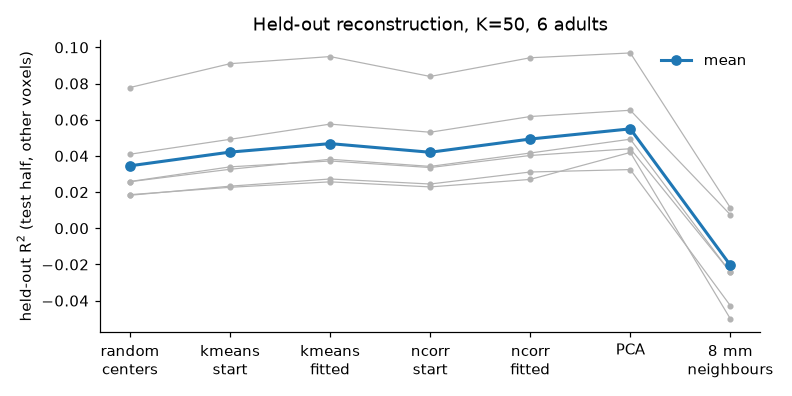
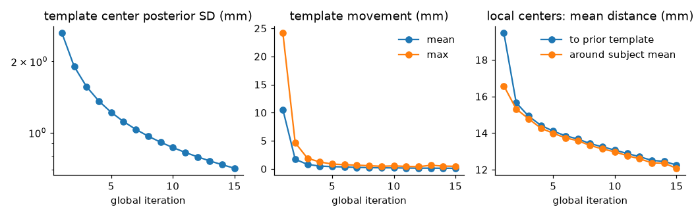
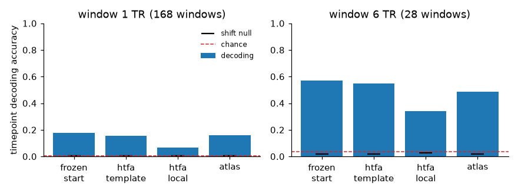

Validation
==========

This page collects the evidence on whether the package estimates what it is meant
to estimate: recovery of known parameters from synthetic data, agreement with the
reference BrainIAK implementation, and checks on real fMRI. Every number below was
produced by a test or by one of the ``scripts/validation_*.py`` scripts in the
repository; the scripts write the CSV files and figures shown here.

Synthetic recovery
------------------

The test suite fits data generated by `htfa.make_tfa_data` and `htfa.make_htfa_data`
with known centers, widths and weights (``standardize=False``):

- ``tests/test_tfa.py::test_tfa_recovers_known_parameters_3d`` (20 x 20 x 20 grid,
  K = 8, T = 100, noise 0.1, seed 0): largest center error 0.0164 grid units and
  largest relative width error 0.0031; the test requires < 0.04 and < 0.008, and a
  correlation above 0.95 between every matched true and estimated weight time
  course.
- The development notes record, for the same data, a 2D fit (40 x 40, K = 6) with
  center error 0.012 and width error 1.0%, a subsampled fit with 0.10 and 1%, and a
  64-fold (centers) and 30-fold (widths) error reduction of the fit relative to its
  own data-driven start, with a final objective within 1.2e-5 of a fit started at
  the true parameters.
- Starting from the true parameters with every factor displaced in a random
  direction and every width halved or doubled (4 trials each), the fit returned to
  the truth (center error 0.016) in all trials for displacements of 0.5 and 1
  factor SD, in 6 of 8 at 2 SD and in 1 of 8 at 3 SD.

BrainIAK cross-check
--------------------

``tests/test_brainiak_crosscheck.py`` (marker ``brainiak``) runs BrainIAK 0.12 next
to this package on the same synthetic data (12 x 12 x 12 grid, K = 4, T = 50,
noise 0.1):

- The data-term residual agrees with BrainIAK's to 7.6e-8 (relative), and the RBF
  factor images to 2.5e-14.
- TFA, seeds 0/1/2, largest center error: 0.020/0.020/0.016 (this package) and
  4.89/0.87/0.086 (BrainIAK's K-means start and default stopping), in 2-3 s versus
  4-6 s.
- HTFA with 3 subjects, largest template center error relative to the mean of the
  true subject centers: 0.051/0.058/0.061 (this package) and 4.79/3.81/4.45
  (BrainIAK).

Faster evaluations, same answers
--------------------------------

The cost evaluations of the center/width solver were made cheaper
(per-axis factors on grid coordinates, reuse of a cost evaluation in the
Hessian assembly, the projected objective from ``||X||**2 - <F^T X, W>``; see
:doc:`performance`). Three checks compare the new code with commit
``3298278``, the code before those changes.

**Kernels over generated scenarios** (``tests/test_equivalence.py``). The
oracle is ``tests/reference_kernels_3298278.py``, the kernel module of
``3298278`` unchanged. Each scenario draws one value from every family below,
with seeded random sizes and parameters; 480 scenarios, plus 12 large ones
(V = 6000, D = 2 and 3, K = 50 and 100, T = 1, 168 and 300; marked
``slow``), each at three
points (the scenario's centers and widths and two perturbations of them).

.. list-table:: Scenario families
   :header-rows: 1

   * - family
     - values
   * - D
     - 2, 3 (TFA accepts only these)
   * - coordinates
     - regular grids with offset origins and anisotropic voxels (1 to 4 mm per
       axis), MNI-like 2 mm ellipsoid masks, rotated (oblique) grids, jittered
       grids, grids offset by 1e6 mm, uniform random clouds; both the per-axis
       and the direct path occur
   * - sizes
     - V = K // 2 (fewer voxels than factors for K >= 2; V = 1 for K = 1), 20
       to 300, or 2000; T 1 to 40; K 1 to 30
   * - widths
     - tiny (factors 0 or subnormal at almost every voxel), small, typical,
       huge (factors about 1 everywhere), mixed over ten decades
   * - centers
     - inside, at the edge of, and 2 to 5 extents outside the voxel cloud
   * - special
     - none; near-duplicate factors (1e-6 apart); a vanishing factor; a
       near-singular gram; every factor below 1e-154 at every voxel
   * - weights
     - ``'rr'``, ``'ols'``
   * - loss
     - varpro (linear), linear (compressed residual problem), ``soft_l1``,
       ``huber``, ``linear+soft_l1``
   * - prior
     - none, a random HTFA prior
   * - data
     - noiseless; an exact fit (X = F W at the scenario's own factors, so the
       residual is 0); noise for R² about 0.04; t-distributed (2 dof) noise;
       30% constant voxels; per-voxel mean offsets of about 100

Every quantity is compared on a scale that does not shrink with the fit:
factors per entry (normal numbers, 1e-12; subnormal entries within the
smallest normal number); costs relative to the cost of the zero model plus
the prior terms; ``F W`` relative to ``max|X|``; weights relative to their largest
entry; the gradient relative to ``sqrt(2 cost_scale lambda_max)`` of the
fixed-weight Gauss-Newton matrix; the Gauss-Newton matrix and Hessian
relative to the largest of their own, the fixed-weight matrices and the
coupling terms between the two. The tolerance is 1e-10, or 100 x
amplification x the measured factor difference where that is larger, with
the amplification the gram's condition number on its kept eigenvalues
(varpro) or ``max(|F| |W|) / max|X|`` (weights that cancel); the largest ratio of
an observed difference to amplification x factor difference was 23.7 (the
varpro Hessian, whose coupling terms use the gram inverse twice) and 1.3 for
every other quantity. No tolerance may reach 1e-6.

Results over 14811 comparisons (``scripts/equivalence_summary.py --slow``).
Tolerances: median 1e-10, maximum 9.0e-7, 297 above 1e-8.

.. list-table:: Kernel differences (median / max)
   :header-rows: 1

   * - quantity
     - varpro
     - linear
     - soft_l1
     - huber
   * - cost
     - 1.5e-16 / 7.7e-10
     - 0 / 1.1e-17
     - 0 / 1.9e-16
     - 0 / 1.8e-15
   * - gradient
     - 3.9e-20 / 4.6e-10
     - 0 / 1.1e-13
     - 0 / 3.1e-13
     - 0 / 5.7e-14
   * - Gauss-Newton matrix
     - 2.5e-27 / 1.2e-9
     - 1.0e-41 / 1.1e-13
     - 0 / 1.5e-13
     - 0 / 4.4e-14
   * - Hessian
     - 3.9e-20 / 1.3e-7
     - 1.5e-24 / 1.7e-13
     - 1.2e-38 / 4.5e-13
     - 1.1e-29 / 9.2e-14
   * - weights / F W
     - 0 / 4.5e-10, 0 / 9.2e-10
     -
     -
     -

Factors differed by at most 2.0e-13 per entry and their derivatives by
1.1e-13. The largest varpro difference, 1.3e-7 in the Hessian at a
tolerance of 5.4e-7, is in an 'ols' scenario with near-singular factors.

Of the 1476 points, 132 varpro stages were not fully compared with the oracle:

- 120 stages in 46 scenarios where every gram eigenvalue is below
  ``GRAM_FLOOR`` (every factor below about 1e-146 at every voxel). The
  earlier code's gram inverse overflowed at some of these points (NaN costs at
  76 of 286) and fitted factors of 1e-155 with weights of 1e155 at the others;
  the current code counts such factors as 0. There the test checks the
  current code itself: weights 0, cost equal to the zero model's, and the
  ValueError for a start there.
- 12 stages in 8 scenarios (all 'ols'; huge widths, near-duplicate or
  near-singular factors) whose amplification (the condition number of the
  kept gram eigenvalues) is 6.3e6 to 6.1e7, just below the truncation cutoff
  (6.7e7). Neither version's weights and derivatives are determined to
  better than about that times 1e-16 there (the tolerance would have to be
  1.1e-6 to 4.1e-4), so only the cost and ``F W`` are compared, at 1e-8:
  measured differences at most 3.9e-10 and 1.8e-9.

63 varpro points have a gram eigenvalue ratio within a factor 100 of the
truncation cutoff. At 57 both versions keep the same eigenvalues and they are
compared as above; the other 6 are among the points where every factor
vanishes.

Error injection (each into the current code, then the sweep rerun): a
relative 1e-9 change of one factor column failed 315 scenarios, of the
identity cost 125, and of one row of the weights 77 (11 of them
near-duplicate 'ols' scenarios). A reuse test interleaves cost and Hessian
calls where only the widths, only the centers, or only the prior's centers or
widths (in place) change, and repeats points after other ones: every result
equals that of a fresh problem with an empty cache bit for bit. A cache
keyed on the widths only failed 32 of its 40 cases, one keyed on the centers
only 32, and a cost cached on the point alone (ignoring prior changes) 27.

**Whole fits, well-conditioned synthetic problems**
(``tests/test_fit_equivalence.py``). 36 candidate problems (2D grids 20 x 20,
30 x 30, 25 x 15 and 3D grids 10³, 12³, 14 x 10 x 8; K = 2, 4, 6; noise 0.1
and 0.5), fitted with the defaults by the current code and by the same
``TFA`` running on the 3298278 kernels, both on the machine that runs the test
(saved outputs would carry one platform's BLAS rounding). A problem counts as
well-conditioned when the 3298278 fit recovers the true centers to 0.2
lengths ``sqrt(max_sigma / 2)`` and is stable: its fit on the data changed by
a relative 1e-12 agrees with it within the tolerances below. Only those are
compared; at least 30 must qualify. Tolerances are those of the stopping rule
(``threshold`` = 1e-3: centers in lengths, widths and weights relative) and
1e-8 for the cost. On macOS (Accelerate) 35 qualified (the one excluded
ends at a local optimum, centers 1.75 lengths from the truth); on Linux
(OpenBLAS, Python 3.10) all 36, with differences of at most 1.5e-9 (centers),
6.2e-8 (widths), 2.8e-8 (weights) and 6.3e-11 (cost).

.. list-table:: Whole-fit differences, 35 well-conditioned fits (macOS)
   :header-rows: 1

   * - quantity
     - median
     - max
   * - centers (lengths)
     - 3.2e-16
     - 1.2e-8
   * - widths (relative)
     - 1.9e-15
     - 1.4e-7
   * - weights (relative to the largest)
     - 1.2e-15
     - 9.5e-8
   * - cost (relative)
     - 0
     - 1.1e-10

**Whole fits, real data at K = 100.** Six development_fmri adults, training
segment of the held-out protocol above (all voxels, 80 samples, ``init='ncorr'``,
``standardize=False``), held-out R² scored as above:

.. list-table:: K = 100, 3298278 / new code
   :header-rows: 1

   * - subject
     - objective (relative difference, new - old)
     - held-out R² (ridge)
   * - sub-pixar123
     - +5.2e-9
     - 0.0394750 / 0.0394750
   * - sub-pixar124
     - +4.2e-15
     - 0.1023571 / 0.1023571
   * - sub-pixar125
     - -1.4e-5
     - 0.0514058 / 0.0514142
   * - sub-pixar126
     - -3.4e-10
     - 0.0351641 / 0.0351642
   * - sub-pixar127
     - +1.7e-13
     - 0.0762920 / 0.0762920
   * - sub-pixar128
     - -7.6e-13
     - 0.0499928 / 0.0499928

Objectives are equal within the solver's ``ftol`` (1e-8) or lower, and the
held-out R² values differ by at most 8.3e-6 (sub-pixar125, which stopped after
2 instead of 9 outer iterations at a 1.4e-5 lower objective).

Reproducibility
---------------

A fit repeated with the same inputs, settings and ``random_state`` in the same
process gives identical results, bit for bit, and an HTFA's results do not
depend on ``n_jobs`` (``tests/test_htfa.py::test_htfa_bitwise_independent_of_n_jobs``,
in both modes). Across processes this also holds where the BLAS library
computes the same bits in every process. On Windows with some AMD EPYC CPUs
(measured on 9V45 and 9V74), OpenBLAS rounds differently in about 0.5 to 2.5% of
freshly started processes, so two runs of the same fit are not guaranteed to
agree bit for bit there; the differences start at rounding level.

Real fMRI: data
---------------

The real-data results below were computed with the package at commit ``ff7fe1f``
(default solver ``nlss_method='bounded-lm'``) by the scripts in ``scripts/``.

They use the first twelve adult participants of nilearn's ``development_fmri``
dataset (`nilearn.datasets.fetch_development_fmri`, ``sub-pixar123`` to
``sub-pixar134``). All participants watched the same short movie (Pixar's "Partly
Cloudy"); each run has 168 volumes, TR = 2 s, 4 mm MNI space. Voxels are those of
nilearn's MNI152 brain mask resampled to the data, excluding voxels whose mean
intensity is below 10% of the median and voxels that are nearly constant over any
quarter of the run (23,726 to 27,986 voxels per subject). Each segment of data
used is linearly detrended and the dataset's reduced confound set (6 motion
parameters, framewise displacement, 6 aCompCor components, CSF and white-matter
signals) is regressed out. :mod:`htfa.datasets` (used by
``scripts/validation_data.py``) does this preprocessing.

Held-out reconstruction: does inference help?
---------------------------------------------

``scripts/validation_heldout.py`` asks whether fitting the centers and widths
(inference) improves on the start it begins from, on data the fit never saw. For
each subject:

- Samples 0-79 are the training segment and samples 88-167 the test segment (an
  8-sample gap). Each segment is cleaned on its own samples; z-scoring means and
  SDs are estimated on the training segment and applied unchanged to the test
  segment, which is passed with ``standardize=False``.
- TFA (K = 50, ``max_voxels=10000``, ``max_trs=84``, so all 80 training samples,
  ``random_state=0``) is fitted on the training segment from the 'ncorr' start and
  from the 'kmeans' start (BrainIAK's), once with ``max_iter=0`` (the start
  itself, "frozen") and once with ``max_iter=20`` (inference). Within each pair,
  the start, K, preprocessing and weight estimator are identical; only the
  iterations differ. All 24 fits stopped on the plateau rule for subsampled fits,
  after 6 to 20 iterations; none stopped on ``threshold``.
- Baselines: the first 50 PCA spatial components of the training segment, and 50
  random voxel locations as centers with the median fitted width.
- Test: the voxels are split into two sets of 16 mm spatial blocks
  (checkerboard). The test-segment weights are estimated from one set (ridge, with
  the penalty frozen at the training variance) and R² is scored on the other set
  against the training-mean predictor; the sets then swap and the two R² are
  averaged.

.. list-table:: Held-out R² (test segment, other voxel set; ``heldout.csv``)
   :header-rows: 1

   * - subject
     - random centers
     - kmeans start
     - kmeans fitted
     - ncorr start
     - ncorr fitted
     - PCA (K = 50)
   * - sub-pixar123
     - 0.0186
     - 0.0233
     - 0.0268
     - 0.0245
     - 0.0330
     - 0.0324
   * - sub-pixar124
     - 0.0802
     - 0.0910
     - 0.0959
     - 0.0839
     - 0.0952
     - 0.0969
   * - sub-pixar125
     - 0.0258
     - 0.0326
     - 0.0391
     - 0.0342
     - 0.0418
     - 0.0492
   * - sub-pixar126
     - 0.0191
     - 0.0226
     - 0.0253
     - 0.0229
     - 0.0278
     - 0.0419
   * - sub-pixar127
     - 0.0425
     - 0.0492
     - 0.0570
     - 0.0531
     - 0.0622
     - 0.0652
   * - sub-pixar128
     - 0.0263
     - 0.0339
     - 0.0375
     - 0.0336
     - 0.0411
     - 0.0440
   * - sub-pixar129
     - 0.0109
     - 0.0153
     - 0.0187
     - 0.0162
     - 0.0214
     - 0.0228
   * - sub-pixar130
     - 0.0271
     - 0.0330
     - 0.0390
     - 0.0340
     - 0.0418
     - 0.0522
   * - sub-pixar131
     - 0.0230
     - 0.0303
     - 0.0346
     - 0.0290
     - 0.0350
     - 0.0374
   * - sub-pixar132
     - 0.0161
     - 0.0246
     - 0.0289
     - 0.0252
     - 0.0360
     - 0.0418
   * - sub-pixar133
     - 0.0211
     - 0.0259
     - 0.0304
     - 0.0265
     - 0.0315
     - 0.0367
   * - sub-pixar134
     - 0.0159
     - 0.0188
     - 0.0239
     - 0.0224
     - 0.0283
     - 0.0413
   * - mean
     - 0.0272
     - 0.0334
     - 0.0381
     - 0.0338
     - 0.0413
     - 0.0468

- Inference raised the held-out R² over its own frozen start in 12 of 12 subjects
  from both starts: by 0.0050 to 0.0113 (mean 0.0075) from 'ncorr' and by 0.0027
  to 0.0079 (mean 0.0047) from 'kmeans'. It also lowered the training objective in
  every fit (by 0.55% to 1.1% from 'ncorr' and 0.47% to 0.88% from 'kmeans').
- Both starts beat random centers in every subject. The fitted 'ncorr' solution
  has the higher held-out R² of the two fitted solutions in 11 of 12 subjects and
  the lower training objective in 12 of 12.
- Matched-K PCA reconstructs the held-out voxels better than both fitted TFA
  solutions in 11 of 12 subjects (mean 0.0468; 0.0814 with ordinary least-squares
  test weights, where the ridge penalty of 1 no longer shrinks the unit-norm PCA
  maps). With OLS test weights the gain of inference is unchanged from 'ncorr'
  (mean 0.0074) and smaller from 'kmeans' (mean 0.0023, positive in 12 of 12).
  PCA components are unconstrained spatial maps, whereas TFA factors are 50
  radial basis functions.
- The absolute values are small: after confound regression and per-voxel
  z-scoring, 50 factors explain 2.4% to 7.4% of the training-segment variance. A
  model-free reference that predicts each voxel by the unweighted mean of the
  other set's voxels within 8 mm scores below zero in 10 of 12 subjects (mean
  -0.029).
- The fitted 'ncorr' and 'kmeans' solutions do not converge to the same factors:
  their matched centers are 16.4 mm apart on average at the start and 21.5 mm
  after fitting.

Loss and solver
~~~~~~~~~~~~~~~

The same protocol with all voxels and samples of the training segment
(``max_iter=100``, the 'ncorr' start, K = 50; load average 15 to 80, so the
times are inflated) compares the losses and solvers behind the defaults:

.. list-table:: Held-out R² by loss and solver (12 adults, mean)
   :header-rows: 1

   * - loss, solver
     - held-out R² (ridge / OLS test weights)
     - training R²
     - seconds per subject (mean)
     - outer iterations
   * - linear, ``'varpro'`` (the default)
     - 0.04241 / 0.04209
     - 0.0502
     - 38
     - 2 to 27 (threshold)
   * - linear, ``'bounded-lm'`` alternation
     - 0.04239 / 0.04207
     - 0.0496
     - 54
     - 100 (max_iter)
   * - soft_l1, ``'bounded-lm'`` alternation (the earlier default)
     - 0.04231 / 0.04202
     - 0.0494
     - 392
     - 100 (max_iter)
   * - ``'linear+soft_l1'`` (varpro, then soft_l1)
     - 0.04224 / 0.04194
     - 0.0499
     - 466
     - 2 to 27, then 100 (max_iter)

The linear-loss fit holds out as well as the robust one at a tenth of the time.
On synthetic data with heavy-tailed noise (`htfa.make_tfa_data` plus 0.3 times
Student-t(3) noise, K = 6 in 2D and K = 8 in 3D, seeds 0 to 2) the robust loss
recovers the centers somewhat more closely: mean largest center error 0.079 /
0.080 / 0.091 (2D) and 0.070 / 0.070 / 0.074 (3D) for ``'soft_l1'``, the
two-stage fit and the linear varpro fit. With Gaussian noise only (noise 0.1)
the means were 0.0121 / 0.0121 / 0.0123 (2D) and 2.26 / 0.0153 / 0.0153 (3D):
in 3D one of the three ``'soft_l1'`` fits (all from the 'ncorr' start) stayed
in a worse solution, while the two-stage and varpro fits recovered every seed.

HTFA template update (audit)
----------------------------

``scripts/validation_template.py`` fits `htfa.HTFA` unchanged to the twelve adults
(cleaned full runs, ``standardize='auto'``; K = 50, ``max_global_iter=15``,
``max_local_iter=5``, ``max_voxels=5000``, ``max_trs=168``, ``init='ncorr'``
only, because the 'kmeans' start costs about a minute per subject,
``random_state=0``) and records, through wrappers around ``htfa.htfa.map_update``
and ``HTFA._fit_subjects``, what enters and leaves each template update. The fit
ran all 15 global iterations without reaching ``threshold`` (scaled change 0.011
at the last iteration).

The template update follows BrainIAK: each global iteration computes a Gaussian
posterior of the template from the subjects' current local estimates, and that
posterior becomes the prior of the next iteration, which revisits the same
subjects. With the subject-level covariance ``Sigma`` (the template subject's
coordinate covariance scaled by ``K^(-2/3)``) and the initial prior covariance
``S0`` (equal to ``Sigma`` in the package), the posterior covariance after ``i``
iterations with ``n`` subjects is ``S_i = (S0^-1 + i n Sigma^-1)^-1``: each pass
counts the same subjects again. The covariance does not depend on the data, and it
is identical for every factor. The width variance follows the same recursion,
``v_i = v0 / (1 + i n)``.

Checks on the recorded real-data inputs:

- The package's MAP update agrees with an independent precision-form Gaussian
  posterior (``P = S0^-1 + n Sigma^-1``, ``m = P^-1 (S0^-1 m0 + Sigma^-1 sum(obs))``)
  to 4.3e-14 mm for the means and 4.4e-16 (relative) for the covariances, over all
  750 factor updates.
- The recorded posterior covariance matches the closed form above to 7.8e-16
  (relative) at every iteration, and is identical across factors (largest
  difference 0).

.. list-table:: Template audit, 12 subjects, K = 50 (``template_audit.csv``)
   :header-rows: 1

   * - global iteration
     - 1
     - 2
     - 3
     - 5
     - 10
     - 15
   * - posterior SD of each template center (mm, per axis)
     - 2.64
     - 1.90
     - 1.57
     - 1.22
     - 0.87
     - 0.71
   * - mean template movement (mm)
     - 10.56
     - 1.72
     - 0.79
     - 0.40
     - 0.18
     - 0.12
   * - mean distance of local centers to the prior template (mm)
     - 19.5
     - 15.7
     - 14.9
     - 14.1
     - 13.1
     - 12.2
   * - mean distance of local centers to their across-subject mean (mm)
     - 16.6
     - 15.3
     - 14.8
     - 14.0
     - 13.0
     - 12.1

The posterior SD of each template center falls from 2.64 mm after the first pass
to 0.71 mm after 15 passes, as the closed form predicts, while the subjects' local
centers stay 12 to 20 mm from the template. The width variance falls in the same
way, to 18.5 mm² after 15 passes (from about 3.4e3 mm²).

As a control (``--fixed-cov``, not the package's behaviour), the script recomputes
every center update from the initial prior covariance, so the template center
covariance stays at its one-pass value (posterior SD 2.64 mm); the widths are
unchanged. With the same seed:

.. list-table:: Shrinking (HTFA as implemented) versus fixed template covariance
   :header-rows: 1

   * - global iteration
     - 2
     - 4
     - 8
     - 12
     - 15
   * - mean template movement, shrinking (mm)
     - 1.72
     - 0.50
     - 0.22
     - 0.13
     - 0.12
   * - mean template movement, fixed (mm)
     - 3.31
     - 1.38
     - 0.99
     - 1.03
     - 1.32
   * - local-center spread around the subject mean, shrinking (mm)
     - 15.3
     - 14.3
     - 13.3
     - 12.6
     - 12.1
   * - local-center spread around the subject mean, fixed (mm)
     - 15.3
     - 14.6
     - 14.3
     - 14.2
     - 14.2

With the shrinking covariance, the template movement keeps decreasing (to 0.12 mm
per iteration) and the subjects' local centers keep moving closer together
(spread 16.6 mm after the first iteration, 12.1 mm after 15). With the covariance
held at its one-pass value, the template movement stays between 0.88 and 1.40 mm
per iteration from iteration 6 on, and the spread stays between 14.2 and 14.5 mm. The
continued decrease of the template movement, which the HTFA stopping rule
measures, and the continued pull of the subjects toward each other therefore come
in part from the shrinking prior covariance rather than from the data. BrainIAK's
update stays the default (``template_update='brainiak'``); the alternatives are
compared below.

         distances over 15 global iterations.

Template update options
~~~~~~~~~~~~~~~~~~~~~~~

`htfa.HTFA` takes ``template_update='brainiak'`` (the update above, the
default), ``'fixed'`` (the subject-level prior covariance stays at its initial
value ``Sigma``, and the template is the mean of the matched local estimates,
which minimizes the summed penalized local objectives over the template) or
``'empirical'`` (as ``'fixed'``, with ``Sigma`` and the width variance estimated
once from the across-subject dispersion of the matched unpenalized stage-0 fits,
robust to factor mismatches; `htfa.htfa.empirical_dispersion`). All three use
the global stopping rule of `htfa.HTFA`: the scaled template change reaches
``threshold``, or it has not fallen below 0.9 times its lowest value so far in
three consecutive iterations ("plateau"; a decrease slower than 10% per iteration
counts as a plateau), or the summed final local objectives changed by less than
a relative 1e-5 in each of the last two iterations ("objective").

Synthetic data with known truth (`htfa.make_htfa_data`, ``init='ncorr'``,
soft_l1 loss, ``max_global_iter=30``, seeds 0 to 2, means over seeds; errors in
grid units; "free" is the independent TFA fits of stage 0, with the template as
the mean of their matched centers; load average 40 to 80):

.. list-table:: Template updates on synthetic data
   :header-rows: 1

   * - case
     - update
     - global iterations
     - seconds
     - max global center error
     - mean local center error
   * - 4 subjects, 15³, T = 80, K = 6, noise 0.1
     - brainiak / fixed / empirical / free
     - 11.7 / 2.7 / 3.0 / -
     - 13.1 / 10.7 / 11.2 / -
     - 1.98 / 1.97 / 1.97 / 2.34
     - 0.230 / 0.230 / 0.230 / 0.326
   * - 8 subjects, 20³, T = 60, K = 10, noise 0.1
     - brainiak / fixed / empirical / free
     - 18.0 / 5.0 / 5.0 / -
     - 87.2 / 72.7 / 79.1 / -
     - 1.65 / 1.31 / 1.64 / 2.23
     - 0.224 / 0.193 / 0.245 / 0.674
   * - 4 subjects, 15³, T = 30, K = 6, noise 2.0
     - brainiak / fixed / empirical / free
     - 11.0 / 4.0 / 5.0 / -
     - 21.7 / 12.9 / 14.6 / -
     - 8.22 / 7.73 / 7.88 / 7.04
     - 2.92 / 2.97 / 3.12 / 3.03
   * - 8 subjects, 20³, T = 30, K = 10, noise 2.0
     - brainiak / fixed / empirical / free
     - 25.3 / 4.7 / 4.7 / -
     - 200.8 / 111.7 / 115.7 / -
     - 5.44 / 5.76 / 6.27 / 5.96
     - 1.87 / 2.10 / 2.06 / 2.79

(The 'empirical' rows predate its Mahalanobis trimming.) Without the shrinking
covariance the global loop stops in 3 to 5 iterations instead of 12 to 25, with
the same or smaller errors on the clean data; at noise 2.0 (where no method
recovers the truth) BrainIAK's shrinkage gives the lowest mean local error in the
larger case, and two of its three fits ran into ``max_global_iter``.

Real data (the twelve adults; ``nlss_loss='linear'``, ``nlss_method='varpro'``,
``init='ncorr'``, K = 50, ``n_jobs=6``, ``n_threads=2``, load average 13 to 40;
held-out R² as in the held-out section, from HTFA fitted to the training segments;
decoding as in the next section, from HTFA fitted to the full runs):

.. list-table:: Template updates on real data
   :header-rows: 1

   * - update
     - global iterations (training / full runs)
     - seconds (training / full runs)
     - held-out R², local factors
     - held-out R², template factors
     - decoding, local weights (1 / 6 samples)
     - decoding, template factors (1 / 6 samples)
   * - brainiak
     - 10 / 10 (max_global_iter)
     - 394 / 474
     - 0.0413
     - 0.0395
     - 0.061 / 0.316
     - 0.138 / 0.558
   * - fixed
     - 7 / 7
     - 487 / 470
     - 0.0426
     - 0.0388
     - 0.042 / 0.231
     - 0.141 / 0.571
   * - empirical
     - 4 / 4
     - 217 / 172
     - 0.0428
     - 0.0383
     - 0.046 / 0.247
     - 0.124 / 0.510
   * - free (stage-0 TFA)
     - -
     - -
     - 0.0426
     - -
     - 0.029 to 0.031 / 0.15 to 0.21
     - -

The shrinking covariance pulls each subject's factors toward the template: its
local factors decode better across groups (0.316 against 0.231 and 0.247 with
6-sample windows) and reconstruct the subject's own held-out data worse (0.0413
against 0.0426 and 0.0428, the level of independent fits). The template factors
score about the same with all three updates. The default stays
``'brainiak'`` (user decision, 2026-10-26).

Timepoint decoding
------------------

Because all participants watched the same movie, a moment of the movie should
evoke similar factor activity in different people. ``scripts/validation_decoding.py``
tests this with across-group timepoint decoding, after Manning et al. (2018,
NeuroImage, doi:10.1016/j.neuroimage.2018.01.071): the twelve adults are split into
two groups of six (all 462 distinct splits); each feature is z-scored over time
within subject and averaged over the subjects of each group; the time course is
averaged within non-overlapping windows of 1 or 6 samples; and every window of one
group is matched to the window of the other group with the highest Pearson
correlation across features. Accuracy is the fraction of windows matched to
themselves, averaged over both directions. Chance is 1 / (number of windows). A
null shifts the second group's time course circularly by a random number of
windows.

Features (from the cleaned full runs, z-scored per voxel):

- ``htfa_template``: ridge weights of each subject's data on the fitted HTFA
  template factors (K = 50, the fit of the audit above);
- ``htfa_local``: each subject's own HTFA weights (``weights_``, in template order);
- ``frozen_start``: ridge weights on the 'ncorr' start of one subject
  (``sub-pixar123``) without iterations (``max_iter=0``), same K, applied to every
  subject;
- ``atlas``: mean signal in each of the 48 Harvard-Oxford cortical parcels
  (maximum-probability map, 25% threshold).

.. list-table:: Decoding accuracy, mean over 462 splits (``decoding.csv``)
   :header-rows: 1

   * - features
     - 1-sample windows (168; chance 0.006)
     - 6-sample windows (28; chance 0.036)
   * - frozen start
     - 0.178 (null 0.005)
     - 0.570 (null 0.016)
   * - HTFA template factors
     - 0.154 (null 0.005)
     - 0.549 (null 0.018)
   * - HTFA local weights
     - 0.065 (null 0.006)
     - 0.341 (null 0.025)
   * - Harvard-Oxford atlas, 48 parcels
     - 0.161 (null 0.006)
     - 0.484 (null 0.019)

All four feature sets decode far above chance and above the shift null. The
fitted template factors do not decode better than the frozen start they are
compared with (0.549 versus 0.570 with 6-sample windows, 0.154 versus 0.178 with
single samples); both decode better than the 48-parcel atlas with 6-sample
windows. Each subject's own HTFA weights decode worst (0.341): their factors are
matched to the template by index, but the local centers lie 10.2 to 14.6 mm from
the template centers on average (audit above), so factor ``k`` does not cover the
same region in every subject. The splits share subjects, so the 462 accuracies
are not independent; the minimum over splits is in ``decoding.csv``.

         and the shift null.

Fast and exact modes
--------------------

`htfa.TFA` and `htfa.HTFA` fit in ``mode='fast'`` by default. It differs from
``mode='exact'`` (the reference, and the behavior of earlier versions) in the
solver's step where the Hessian is indefinite and in the precision of the
curvature (:doc:`performance`, "Fast and exact modes"). Both minimize the same
objective, so on a well-conditioned problem they should reach the same fit,
and on a problem with several local minima they can reach different ones. The
checks below compare the two modes computed on the same machine.

**Synthetic data** (``tests/test_fast_mode.py``, on macOS with Accelerate and
on Linux with OpenBLAS):

- Single solves, the solver families of ``tests/test_kernels.py`` (44
  solves: test problems in 2D and 3D, with and without a prior, and
  `htfa.make_tfa_data` solves; linear and ``soft_l1`` losses): 42 agree with
  the exact solve within 1e-9 (relative cost). The other two, a 3D solve
  started from a prior where the first step meets negative curvature, end
  4.2e-4 (linear) and 3.8e-4 (``soft_l1``) higher, with centers 6.8 and 6.4
  grid units apart; the exact mode takes the Gauss-Newton step there to avoid
  that jump (``test_bounded_lm_does_not_jump_basins_on_indefinite_hessian``).
  The test allows at most 1e-3 and only in these two cases.
- Whole TFA fits, the 36 problems of the fit equivalence test above plus 20
  more (``soft_l1``, the two-stage loss, ``'ols'`` weights, a prior and
  ``nlss_method='bounded-lm'``; 2D and 3D, K = 4 and 8), with the same
  well-conditioning criterion: 54 qualified on macOS and 55 on Linux, and on
  each the fast fit is within the stopping tolerances of the exact fit. The
  largest differences were 5.1e-8 lengths (centers), 1.9e-7 (widths), 1.2e-7
  (weights) and 2.3e-10 (cost). On these problems the solves meet negative
  curvature rarely, so these fits mostly test the float32 curvature.
- Families where the Hessian is indefinite at most steps, as on real fMRI
  (15 fits, 3 seeds each: three times as many factors fitted as generated,
  15 for 5 in 3D and 18 for 6 in 2D; noise of standard deviation 3; K = 24 on
  a 16³ grid; noise of standard deviation 4 with 24 factors fitted to 16). The exact solver
  met an indefinite Hessian at 47% to 93% of its accepted steps per fit (44%
  to 93% on Linux), 79% on average. Here the modes reach different minima, so
  the reference is the exact mode's own variation: exact fits from three other
  K-means seeds. The fast objective must be at most twice that spread above
  the exact fit's (measured: at most 1.0 times it) and its error in
  reconstructing the noiseless signal at most 1.1 times the worst exact
  fit's (measured: at most 1.03 times). The fast objective was lower in 11 of
  the 15 fits on macOS.
- Whole HTFA fits (3 subjects; 2D and 3D, K = 3 and 6, the three template
  updates, linear and ``soft_l1``; 24 problems). A problem qualifies when the
  exact template recovers the truth, is stable under a 1e-12 change of the
  data, and ends within 0.1 lengths of the exact fit started from the true
  parameters (18 qualified on each platform). The fast templates are within
  2.9e-5 lengths of the exact ones, the summed objectives within 7.6e-8, and
  the test allows 1e-3 and 1e-6. One excluded problem shows the other side:
  on Linux the exact fit stopped 0.17 lengths from the truth and the fast fit
  0.028.
- BrainIAK cross-check: the recovery errors of the cross-check above are the
  same in both modes, to the printed 4 digits.
- The HTFA fits are independent of ``n_jobs`` bit for bit in both modes, and
  repeated fits are identical (``tests/test_htfa.py``,
  ``tests/test_fast_mode.py``).

**Real fMRI, TFA** (``scripts/validation_modes.py``): the twelve adults, TFA
with its defaults (``init='auto'``, all voxels) on the cleaned, z-scored
runs, in both modes. Objectives are of the full-run fits; held-out R² uses
fits to the training segment and the A/B scoring of the held-out section
above (all voxels and default stopping here, unlike that section's capped
fits); decoding uses the procedure of the previous section with each
subject's full-run factors in turn as the shared factor set (ridge weights of
every subject's run on them), averaged over the twelve factor sets.

.. list-table:: Fast against exact, 12 adults (``modes.csv``)
   :header-rows: 1

   * - quantity
     - K = 50
     - K = 100
   * - objective, fast - exact (relative): range, subjects lower
     - -4.5e-4 to +2.7e-4, 9 of 12
     - -4.7e-4 to +3.4e-4, 5 of 12
   * - held-out R² (ridge), mean exact / fast
     - 0.0427 / 0.0429
     - 0.0506 / 0.0507
   * - held-out R², fast - exact per subject (subjects higher)
     - -0.0011 to +0.0016 (6 of 12)
     - -0.0016 to +0.0014 (7 of 12)
   * - decoding, 1-sample windows, exact / fast
     - 0.139 / 0.130
     - 0.178 / 0.181
   * - decoding, 6-sample windows, exact / fast
     - 0.513 / 0.502
     - 0.611 / 0.603

The fast fits end at other local minima, below the exact ones for 9 of 12
subjects at K = 50 and 5 of 12 at K = 100. Held-out reconstruction is the
same on average; per subject it differs by up to 0.0016 in R², in both
directions. Fast-mode decoding is lower by 0.009 (1-sample windows) and 0.011
(6-sample windows) at K = 50, and differs by +0.002 and -0.009 at K = 100.
Between the twelve factor sets of the exact mode, the accuracy ranges from
0.105 to 0.165 (K = 50, 1-sample windows); the splits and factor sets are not
independent, so no significance test is given. Seconds per fit are in
:doc:`performance` (this run's times are not comparable: other jobs ran next
to it).

**Real fMRI, HTFA** (``scripts/validation_modes.py --htfa``): `htfa.HTFA` with
its defaults on the twelve adults (K = 50, ``n_jobs=6``), in both modes on the
data as is, and, as the baseline for how far apart two fits of one mode end,
on the data multiplied by ``1 + 1e-12 N(0, 1)`` (three seeds in exact mode, one
in fast mode). Each was fitted to the full runs and to the training segments
(held-out R² of each subject's local factors, scored as above). With the
default ``max_global_iter=10`` no fit met the global stopping rule.

.. list-table:: HTFA against the exact fit, 12 adults, K = 50,
   ``max_global_iter=10`` (``modes_htfa.csv``)
   :header-rows: 1

   * - fit
     - template centers, median / max distance (mm)
     - template subject's stage-0 fit, median distance (mm)
     - summed objective (relative)
     - held-out R² (training-segment fit)
   * - exact
     - 0 / 0
     - 0
     - 0
     - 0.04127
   * - exact, perturbed (3 seeds)
     - 2.0 to 5.6 / 8.8 to 13.6
     - 1.4e-4 or less
     - -6.0e-4 to +1.1e-3
     - 0.04127
   * - fast
     - 15.8 / 42.3
     - 16.4
     - -9.5e-4
     - 0.04078
   * - fast, perturbed
     - 14.7 / 38.9
     - 16.4
     - -1.3e-3
     - 0.04109

The fast template is a different map from the exact one: its centers are
15.8 mm from the exact template's (median), 2.8 to 7.8 times the 2.0 to
5.6 mm by which a 1e-12 change of the data moves the exact template.
The template subject's stage-0 fit (the fit the template starts from) is
16.4 mm from the exact one in fast mode and unchanged by the perturbation in
exact mode; in this run, that is where the two modes part. The summed
objectives of the two fast fits were lower than those of all four exact fits,
by 9.5e-4 and 1.3e-3 relative to the unperturbed one, a difference of the
size of the spread among the exact fits (-6.0e-4 to +1.1e-3). On the training segments the perturbation left the exact
fit unchanged (template within 0.002 mm, held-out R² 0.04127 in all four), and
the fast fits held out slightly worse: 0.04078 and 0.04109, with training
objectives 8.1e-4 and 7.4e-4 above the exact fit's. Run on to the global stopping rule (``max_global_iter=50``; all four fits
stopped on the plateau rule after 14 to 17 global iterations,
``modes_htfa_50.csv``), the picture is the same: the fast templates are 15.8
and 14.4 mm (median; 42.9 and 38.5 mm at most) from the exact one, a
perturbed exact fit 2.3 mm (8.4 mm), and the summed objectives of the fast
fits are 5.4e-4 and 7.5e-4 lower than the exact fit's, the perturbed exact
fit's 6.2e-4 higher. Users who
need the reference template should pass ``mode='exact'``.

.. list-table:: HTFA decoding accuracy, mean over 462 splits, full runs
   (``modes_htfa.csv``)
   :header-rows: 1

   * - fit
     - template factors, 1 / 6-sample windows
     - local weights, 1 / 6-sample windows
   * - exact
     - 0.146 / 0.510
     - 0.082 / 0.345
   * - exact, perturbed (3 seeds)
     - 0.139 to 0.147 / 0.505 to 0.515
     - 0.058 to 0.081 / 0.280 to 0.325
   * - fast
     - 0.122 / 0.541
     - 0.075 / 0.371
   * - fast, perturbed
     - 0.135 / 0.553
     - 0.080 / 0.393

Kernel shapes and mixtures
--------------------------

``kernel`` (``'rbf'``, ``'laplace'``, ``'mexican_hat'``) and ``n_components``
(see :doc:`api` and :doc:`tutorials/12_kernel_shapes`) were checked as follows.
All numbers are from the tests named, on macOS (Accelerate) unless stated.

**'rbf' with one component is unchanged.** The plain RBF fit runs the original
code paths, and calls the kernel functions with the original arguments.
``scripts/rbf_fingerprint.py`` writes 341 arrays (factors, derivatives, costs,
gradients, Gauss-Newton matrices and Hessians of the fixed-weight and varpro
problems with and without a prior, four losses, both modes; ``bounded_lm``
solves; TFA fits with every solver, both modes, subsampling and a prior; HTFA
fits with the three template updates, both modes, serial and ``n_jobs=2``;
synthetic data; effective nodes): on the same machine all 341 are bit for bit
equal to those of main at 0948c13. ``tests/test_fit_equivalence.py`` (TFA on
the frozen 3298278 kernels) and the BrainIAK cross-checks (``-m brainiak``, 27
tests) pass unchanged.

**Derivatives** (``tests/test_kernel_shapes.py``, 188 cases: each kernel with
1 to 3 components, D = 2 and 3, linear, soft_l1 and cauchy losses, with and
without a prior). Against central differences (step 1e-6): the matrix-free
Jacobian within 3.5e-9 (relative to its largest entry), gradients 1.1e-7,
Hessians 1.6e-8, the varpro gradient and Hessian likewise; the Gauss-Newton
matrix and column norms equal the dense Jacobian's to 1.2e-15. Mode 'fast'
changes the varpro Hessian by at most 1.9e-6 (relative).

**Dense oracle sweep** (``tests/test_shape_equivalence.py``). The oracle,
``tests/reference_shapes.py``, writes every factor symbolically from the
definitions of the profiles (the mexican hat as sympy's Laplacian of a
Gaussian) and differentiates it with sympy, then assembles the objectives
densely: the full Jacobian, and for varpro the Schur complement of the joint
Hessian in the centers/widths/logits and the weights, and Kaufman's
Gauss-Newton matrix from the dense weight Jacobian. 240 generated scenarios
(kernel, 1 to 3 components, D = 2 and 3, six coordinate families, 8 to 200
voxels, T = 1 to 7, K = 1 to 4, widths from 1% of ``max_sigma`` to 1e4 times
it, centers inside, at the edge and outside, mixing logits 0, moderate and
near the bounds, 'rr' and 'ols', five losses including varpro, priors, five
data families), three points each: 4135 comparisons. Largest relative
differences: factors 5.7e-14, costs 2.0e-12, gradients 1.4e-12, Gauss-Newton
matrices 5.2e-12, Hessians 4.0e-10 (a varpro point with an ill-conditioned
gram), varpro weights 5.8e-12. Tolerances: 1e-9, or 1e3 x eps x the
amplification (as in the sweep above) where larger; median 1e-9, maximum
3.0e-7. 37 points were not compared: 18 where every factor is below 1e-150 and
19 varpro points where a gram eigenvalue is dropped. A relative 1e-7 error
injected into the mixture curvature of the last logit failed 101 of the 240
scenarios, and into its first derivatives 118.

**Recovery, one component** (``tests/test_shape_fits.py``; ``make_tfa_data``
from each kernel, K = 3, T = 100, noise 0.1, seeds 0 to 5; a case counts when
the default fit ends at least as low as a fit started from the true
parameters). 24 x 24 grid: all 18 cases count; largest center errors 0.0028
(rbf), 0.0055 (laplace) and 0.0022 (mexican_hat) lengths, width errors 2.8%,
5.3% and 1.8%. 18 x 18 x 18 grid: 17 of 18 count; center errors at most 0.0039
lengths, width errors 1.7% (rbf), 1.6% (laplace), 0.6% (mexican_hat). The
excluded case is a 3D mexican hat whose default starts end in a local optimum
(one factor 1.7 lengths off). With the profile ``(1 - z) exp(-z)`` in 3D (whose
surround outweighs its center) instead of the balanced ``(1 - 2z/3) exp(-z)``,
the default starts reached the optimum of 3 of these 6 3D datasets instead of
5 of 6, which is why ``'mexican_hat'`` uses the D-dimensional Laplacian.

**Recovery, two components.** Two factors of two components each, the second
1.5 sigma from the first and 0.4 times as wide (30 x 30 and 16 x 16 x 16
grids, noise 0.05, T = 150, 3 seeds per kernel and D): every default fit reached
the optimum of a fit from the truth, with component centers within 0.0096
lengths, component widths within 10.1% (laplace; rbf 2.5%, mexican_hat 2.1%) and
mixing weights within 0.011 (matched up to the order of a factor's
components). On ``make_tfa_data`` mixtures (second component 0.75 sigma from
the first, 24 x 24, K = 3, 6 seeds per kernel), whose components overlap too
much to be identified one by one, the two-component fits explained within
5.6e-4 of the variance the true parameters explain.

**HTFA** (3 subjects on 24 x 24, K = 3, center jitter 1 voxel, 5 global
iterations): template centers within 0.079 to 0.115 lengths of the global
truth for every kernel, 1 and 2 components and the three template updates (the
mean of three jittered subjects is about 0.08 lengths from it), one-component
template widths within 3.3%. Serial and ``n_jobs=2`` fits are bit for bit equal
for every kernel, 1 and 2 components, and both modes.

**Effective nodes.** An interior node keeps its center; its ``lambda_eff``
measured on a grid is 6.00 w (D = 2) and 7.97 w (D = 3) for ``'laplace'``
(6.02 and 8.01 by radial integration) and 0.281 w and 0.352 w for
``'mexican_hat'`` (0.282 and 0.351), with mass fractions within 0.2% of 1.

**Linux.** ``tests/test_kernel_shapes.py``, ``test_shape_equivalence.py``,
``test_shape_fits.py`` and ``test_fit_equivalence.py`` pass in a
``python:3.12-slim`` container (aarch64, scipy-openblas 0.3.34). There, too,
35 of the 36 one-component recovery cases count; the excluded one is the same
3D mexican hat dataset.

**Tutorial 12** (2D, 30 x 30, K = 5, T = 120, noise 0.3; fit on 60 samples,
factors kept for the other 60). Held-out variance explained, data (rows) by
fitted kernel:

.. list-table::
   :header-rows: 1

   * - data
     - true factors
     - rbf
     - laplace
     - mexican_hat
     - rbf, 2 components
   * - rbf
     - 0.587
     - 0.587
     - 0.569
     - 0.519
     - 0.587
   * - laplace
     - 0.635
     - 0.619
     - 0.635
     - 0.589
     - 0.633
   * - mexican_hat
     - 0.400
     - 0.347
     - 0.291
     - 0.400
     - 0.348
   * - rbf, 2 components
     - 0.464
     - 0.454
     - 0.436
     - 0.405
     - 0.463

Each single-component kernel fits its own data best; on the mixture data the
two-component fit is within 0.001 of the true factors. Its 16 fits took 2.4 s
and the whole notebook 21 s (Apple M2 Max).
